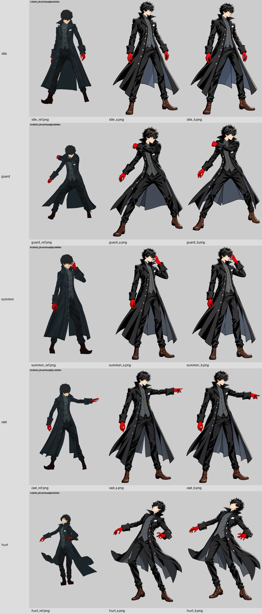
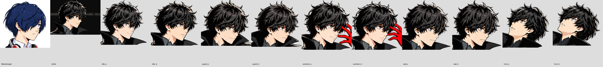

# P5 Joker 姿势图：第二次视线修订暂停报告

日期：2026-10-25。任务基线：`e92fb71d`，分支 `claude/amazing-darwin-b00arn`。

**当前结论：本轮没有完成验收，也没有提交或推送新图。** 用户要求停止后已停止；本报告只整理已有结果，不继续生图。当前保留 10 张，另有 3 张未采用的中间输出。1d 未完成，1c 和 2 尚未开始。

## 1. 本轮做了什么

开始前已 fetch 并快进合并最新提示，读取 ART_SPEC 和 1d / 1c / 2。按 1d，以结城理待机作为头部转角和视线参考，对旧的 idle_a / idle_b / guard_a / guard_b / summon_a 做图像编辑；随后补做 summon_b、cast_a / cast_b、hurt_a / hurt_b。

所有图片都使用**内置 image_gen 图像编辑模式**，请求真透明背景。五张旧图以各自旧图为输入，要求只改头眼；新姿势 A 使用 Joker 母版、结城理视线参考、对应原版动作参考；B 使用 A 微调。没有使用 CLI/API 回退。

文件为工具原始 PNG 副本，未裁剪、抠图、重画眼睛或清理透明通道。缩略图和头部放大图是单独的检查材料，不是母版修改。

## 2. 遇到的困难

### 2.1 头朝右不等于眼睛朝右

提示反复写明“头转开镜头 30–45°、瞳孔靠右眼角、与敌人同高、不要看镜头、不要纯侧脸”，但输出经常只改头部方向，近侧瞳孔仍居中，给人看屏幕的感觉。再强调向右，头又容易转得过侧，远侧眼睛完全藏进刘海。

本轮不是缺少参考：已经逐张把结城理参考、反例、新图放大并排查看；但生成并没有稳定满足这个组合要求。**不能把提示写了这些条件，等同于图片已经做到。**

### 2.2 “只改头眼”没有得到严格保持

虽然明确要求身体、手、腿、衣服不动，工具仍会重算衣襟、纽扣、褶皱、边缘和位置。guard_b 最明显：人物整体向画布上方移动。

对五张旧图，统计 y≥300 区域内新旧主体并集像素；任一 RGBA 通道差值超过 8 的比例为：

| 图片 | 有明显像素差异的主体像素比例 |
|---|---:|
| idle_a | 35.87% |
| idle_b | 23.57% |
| guard_a | 33.76% |
| guard_b | 82.76% |
| summon_a | 35.92% |

这不是“有这么多肢体变形”，而是说明身体区域并非原像素保留，包含色彩、边缘、线条及位置变化。本次调用只有图片输入和文字约束，没有使用像素锁定蒙版；不能承诺严格局部不变。

### 2.3 参考图会污染人物身份

cast_b 第一次生成直接带入了结城理的**蓝头发和脸型**。这张已弃用，随后撤掉结城理图作为该次重试输入，只用 cast_a 编辑，恢复黑发 Joker。正反例参考应当用来检查，但作为生图输入时，即使标明“只参考角度”，仍可能被复制人物造型。

### 2.4 透明和留白仍未达标

10 张都是 1024×1536 RGBA，alpha 范围 0–254。以 alpha≥128 为主体，外扩 16px 后，每张仍存在 alpha=1 的远处残点。严格“轮廓外 alpha 全零”全部不通过。没有使用绿幕，没有擅自阈值清零。

主体全身均入画，但多张的头顶、衣摆、指尖或鞋底离画布边缘过近。表中数值是主体留白，不是完全透明区域宽度。

### 2.5 执行上的问题

在待机和防御视线尚未稳定通过时，我继续做了后面的图，扩大了需要返修的范围。下一次不应把“生成完了”当作“这一张修好了”；应先让一张头眼对照通过，再用同一标准继续。此次停下后没有继续尝试修图。

## 3. 当前 10 张逐项结果

下表是按放大对照做的人工判断，角度不是测量出来的精确三维角度。“接近参考”也不代表瞳孔位置通过。

| 文件 | 头部转角 | 瞳孔位置 | 高光 | 身体、手与动作 | 结论 |
|---|---|---|---|---|---|
| idle_a | 太正，仍有看镜头感 | 近侧居中，远侧部分可见但不够清楚 | 近侧清楚，远侧较弱 | 直立、双手下垂；身体细节漂移 | 视线未通过 |
| idle_b | 接近参考，较 A 侧一些 | 近侧仍偏居中，远侧部分可见；不能确认两眼均偏右 | 可见，远侧受刘海影响 | 不驼背，原站姿大体保留 | 未完全通过 |
| guard_a | 太正 | 近侧居中，远侧看不清 | 近侧清楚 | 横臂防御、直背；拳头遮住部分指头，不能逐根检查 | 未通过 |
| guard_b | 太侧，接近反例 | 近侧偏居中，远侧看不清 | 近侧清楚 | 不驼背，但身体整体上移，局部编辑保持失败 | 未通过 |
| summon_a | 太正 | 近侧居中，远侧被刘海/手指遮挡 | 近侧清楚，远侧无法可靠确认 | 直背、手在脸侧；沿用旧图远侧左手，没有改作右手撕面具 | 未通过 |
| summon_b | 接近参考但偏正 | 近侧仍居中，远侧部分遮挡 | 近侧清楚 | 手腕微调、直背；人物细节略漂移 | 未完全通过 |
| cast_a | 太正 | 近侧居中，远侧遮挡 | 近侧清楚 | 手臂向右指令、直背；原参考为左臂，本任务未限定左右 | 未通过视线 |
| cast_b | 太正 | 近侧居中，远侧遮挡 | 近侧清楚 | 指向角度略降低；黑发身份恢复；上身直立 | 未通过视线 |
| hurt_a | 受击例外，头被打偏并后仰 | 向上偏开，不强求看敌人 | 露出的眼睛可见高光 | 后仰、双臂甩开，无明显多指；部分手指重叠 | 动作接近参考，透明/留白未通过 |
| hurt_b | 受击例外，后仰更大 | 向上偏开，不强求看敌人 | 露出的眼睛可见高光 | 手腕与后仰角度略变，无明显额外肢体 | 动作接近参考，透明/留白未通过 |

所有图的黑长大衣、高立领、灰马甲、金色纽扣、白口袋巾、红手套、黑裤、棕靴总体保留，但不能声称衣服细节和脸部像素完全一致。手指弯曲、握拳和遮挡处不能可靠逐根确认，不把“没看见明显多指”写成完整解剖验收通过。

逐张“三图并排”对照在 `report_1d/gaze_triples/`，原尺寸图片在 `./`，完整提示和生成来源在 `prompts_1d_paused.json`，数值检查在 `alpha_audit_1d_paused.json`。

## 4. 透明数值和留白

留白顺序：左 / 上 / 右 / 下，单位 px；以 alpha≥128 主体计算。远处残点是在该主体外扩 16px 之后的非零 alpha 像素，10 张最大残留 alpha 均为 1。

| 图片 | 主体留白 L/T/R/B | 远处非零残点 |
|---|---|---:|
| idle_a | 81 / 11 / 67 / 26 | 169 |
| idle_b | 83 / 33 / 64 / 29 | 156 |
| guard_a | 45 / 46 / 21 / 38 | 1506 |
| guard_b | 49 / 14 / 29 / 118 | 421 |
| summon_a | 117 / 26 / 96 / 34 | 455 |
| summon_b | 103 / 14 / 84 / 33 | 373 |
| cast_a | 29 / 22 / 24 / 29 | 1015 |
| cast_b | 28 / 20 / 28 / 29 | 1266 |
| hurt_a | 55 / 114 / 33 / 78 | 781 |
| hurt_b | 49 / 79 / 22 / 102 | 623 |

10 张 SHA-256 均与各自工具原始输出一致。原图没有不透明的白底或绿底；显示时黑色或彩色的淡晕不能仅凭预览判定真实底色，数值检查已证实外部不是严格 alpha=0。

## 5. 未采用的 3 张输出

这些仍保留在报告包 `report_1d/rejected/` 供追溯，不写入仓库姿势成品文件。

| 输出 | 原始生成文件 | 未采用原因 |
|---|---|---|
| idle_a 第一版 | exec-7c0d617f-fbf4-4210-9e0c-7cf8949bb7bd.png | 偏侧，远侧眼睛遮挡严重，随后重试 |
| guard_a 第一版 | exec-2bc4d68b-f7c8-4e8c-ab5d-6f7adce84e09.png | 偏侧、远侧眼睛不清楚，随后补入修订待机作参考重试 |
| cast_b 第一版 | exec-91ad62f5-6639-4c41-ade2-70922df0cac1.png | 复制了结城理蓝发和脸型，身份错误，撤掉该参考后重试 |

本轮 13 次均有输出，没有安全策略拒绝，也没有绕过拒绝。此前轮次曾被用户中断的调用不计入本轮 13 张。

## 6. 参考时间与未完成项

沿用已提交的原版参考：idle #1-1 = 0.000000s；guard #10-3 = 0.533333s；summon #50-3 = 0.853333s；cast #58-6 = 1.666667s；hurt #4 的指定点提前 0.1s，实际 0.300000s。没有重新渲这些参考。

- 1d：五张旧图已编辑，summon_b / cast_a,b / hurt_a,b 已生成，但视线和局部不变尚未全部通过；down、victory 未做。
- 1c：小刀斩、开枪均未开始，未产生本轮图。
- 2：右手抓/撕面具全身、面具单图、脸部特写、对应新增参考均未开始。
- kick_a 已按明确要求执行 Git 删除，目前删除处于暂存状态；没有继续生成踢击。
- 旧的 compare_partial.png、README_1b_partial.md、alpha_audit_partial.json 是上一次已提交暂停记录，**不代表此次新图的检查结果**。本报告和新 alpha_audit_1d_paused.json 才对应当前文件。

## 7. 仓库与交付状态

仓库：`C:\Users\kkk\Documents\Codex\2026-10-12\claude-git-c-users-kkk-videos\work\persona-ref-upload`。

本轮新图仍在 `art/p5/poses/` 工作区，旧五张修改未提交，新增五张未跟踪，踢击删除已暂存。**本报告仅落盘整理，没有提交或推送。**

前次保存图片提交是 `347bf92a`，合并推送到 `8284af36`；此次开始前同步到 `e92fb71d`。这些提交号不能当成本轮图已上传的证明。

art/cards 下另一个会话的 11 个修改文件保持原样，没有暂存、提交、stash 或还原；其他无关未跟踪文件未动。未改 mod 代码，未启动游戏，未用 Computer Use。

报告包包含当前 10 张完整 PNG、3 张弃用 PNG、姿势总览、逐张头部三图对照、完整提示和数值检查，可直接交给 Claude 对照分析。原图不是全部达标的最终游戏素材。

## 后续保存

用户随后明确要求推送。本报告、10 张当前图、3 张弃用证据、头部对照和踢击删除一并提交；上文的未提交状态是报告形成时的快照。此次只保存暂停成果，不表示视线验收通过，也不继续制作后续任务。实际提交号见 Git 记录和会话回复。

