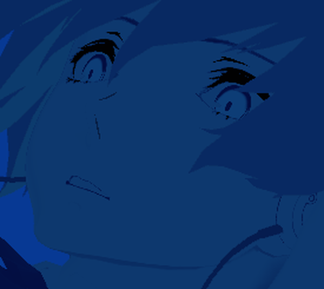

# v0.14.105 眼部、固定裁切和弃牌堆右下标题

## 最终效果

- 弃牌堆 ITEM 睫毛压深到接近黑色；原版面部图集的眼睫区域单独处理，未整体压暗脸部。虹膜在当前填色后增加 5% 亮度，瞳孔黑色与鼻线保留。
- 四个牌堆取消上下边界的透明渐变与 7% 缩小效果。改用原有 GridTop / GridBottom 的固定矩形裁切：边界内保留完整不透明度，越界部分直接裁掉。分类标题也使用同样边界。
- 弃牌堆右下角仅保留 `DISCARD PILE` 与数量。按用户最后要求，白蓝装饰板、淡灰 ITEM 字样和下方说明小字都已删除。
- 标题与数量按字体真实宽度排开，距屏幕右 / 下边缘 24 个参考像素，整组 90% 等比显示。不依赖首帧可能尚未更新的 Label 最小尺寸。

以上是原生 Godot 离线预览局部，背景为纯色；没有启动游戏。

## 动画和交互

- 右下标题：延迟 0.05s 后，用 0.48s OutCubic 从右下方 `(140,40)` 滑入并淡入。
- 关闭时：0.54s InOutCubic，向右下方 `(160,50)` 移出并淡出。
- 立绘维持用户确认的向左退场。标题与立绘分为独立节点，移动方向互不干扰。
- 快速关闭时，从标题当前的位置和透明度接续退出；退出开始后入场回调不再改写位置或透明度，不会先跳回终点再退出。
- 每张卡牌采用独立的固定裁切包装节点。进入特写时仅为这张牌关闭包装节点的裁切，回到网格时恢复。holder 不重新挂载，不触发原版对象池回收。
- 悬停名牌位置补回裁切层偏移；层级调整针对包装节点，保留悬停、点击、翻牌和查看升级的原有流程。

## 检查

- Release 编译通过，0 警告、0 错误。
- 两套游戏 API 兼容检查均通过。
- 原生 D3D12 固定裁切回归：3202 项像素 / 鼠标命中检查通过。覆盖顶部、底部、特写解除裁切与恢复；边界内白色像素保持完整亮度，裁掉部分不响应鼠标；holder 退出场景树次数为 0。原始结果见 `clip_result.json`。
- 眼部 shader 已在 D3D12 和 OpenGL 原生渲染检查，无 shader 编译错误；最终提亮参数在 D3D12 检查。
- 标题实际字体测量：`DISCARD PILE` 字宽 443（92px 字号），数字与标题间距 26 个参考像素；1920×1080、数量 13 时右界 1896、下界 1056，无重叠、无截断。

保留前一轮的鼻线投影修复、四页卡牌 +10%、消耗牌堆同步退场、枪模、慢动作恢复和性能优化。本轮只更新 DLL，资源包沿用 0.14.105。
