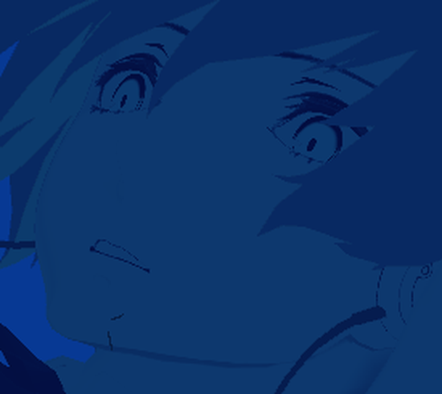
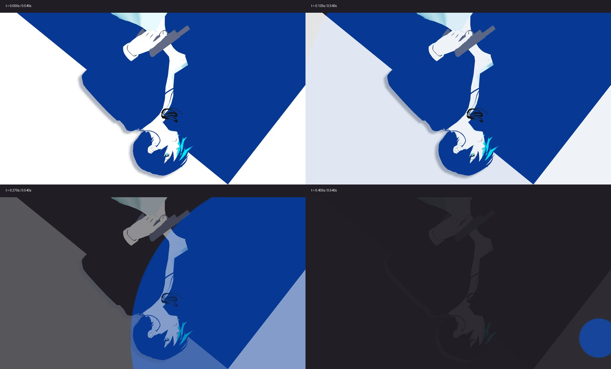

# v0.14.105 实机鼻线定位、同步退场、四页卡牌放大

## 鼻线错位：已重现并修正

上次离线预览只用了居中的透视镜头，没有覆盖实机的偏移视锥。实机 ITEM 使用 KeepWidth + Frustum；Godot 4.5 的 `Camera3D.UnprojectPosition` 在视锥分支构建投影时没有传 KeepAspect，而实际 GPU 渲染会采用 KeepWidth。两种投影不一致，叠加的鼻线因此跑到嘴巴下方。可在 [Godot 4.5.1 Camera3D 源码](https://github.com/godotengine/godot/blob/4.5.1-stable/scene/3d/camera_3d.cpp#L249-L261) 核对该分支。

修正为显式使用 `Projection.CreateFrustumAspect`，传入相同的 KeepWidth、镜头偏移、近平面和视口比例；鼻骨与眼骨通过该矩阵投影到人物显示层。鼻线的形状、颜色、粗细和两端收细保持用户确认版。

下面两张均用实机同样的视锥和最终落位偏移 `(70,-110)`、原版 CampItemLoop 第 20 帧，在 D3D12 原生渲染：

修复前（成功重现实机的下巴鼻线）：

修复后：

回归工具：`tools/compat/HeroProjectionTests/`。用真正的 GPU 3D 彩色探针像素验证投影，不拿旧 API 当正确答案。覆盖 1920×1080、1280×720、1920×1200、2560×1080、1600×1200，以及每种分辨率 7 个入场位置，每位置 3 个不同深度的探针。

- D3D12：105 项通过，最大像素误差 0.506px。
- OpenGL：105 项通过，最大像素误差 0.506px。
- 旧投影在这些用例中最大误差约 257.85px。
- 原始结果见 `result.json` 与 `result_gl.json`。

## 消耗牌堆同步退出

立绘、白底淡出和水域收拢都使用同一条 0.54s 的 InOutCubic 进度。删除先淡出再缩孔的分段等待；白底原地淡出，保留直线边界。关闭水域的起始半径收紧到最远可见角，去掉此前屏外余量造成的视觉等待。

| 时间 | 立绘 / 白底不透明度 | 水域半径比例 |
| --- | --- | --- |
| 0.000s | 1 | 1 |
| 0.135s | 0.9375 | 0.9375 |
| 0.270s | 0.5 | 0.5 |
| 0.405s | 0.0625 | 0.0625 |
| 0.540s | 0 | 0 |

离线采样用纯色水域和深灰底区分两层；原版模型、白底和时间参数相同，未启动游戏。

## 卡牌 +10%，各页分别调整

只调网格中的卡牌，特写牌尺寸保持原有逻辑。仍每排五张，行高从 252 增至 277.2，分类标题和滚动跟随新网格。

下表是 1920×1080 参考值：

| 页面 | 卡宽：原 → 新 | 列间距 | 网格左起点 | 排版处理 |
| --- | --- | --- | --- | --- |
| 牌组 | 166 → 182.6 | 20 | 920 → 837 | 保持右侧留边，向左扩展；总标题跟随左移对齐 |
| 抽牌堆 | 160 → 176 | 18 | 190 保留 | 保持左侧起点，利用右侧空位扩展 |
| 弃牌堆 ITEM | 160 → 176 | 16 | 120 → 50 | 利用原有左侧空白，五列总右边界保持 1010，给脸部留出原来的空间 |
| 消耗牌堆 SKILL | 160 → 176 | 12 | 190 保留 | 保持原左起点，略收紧列间距，减少向人物侧的扩张 |

已按实际 ±2° 静态倾斜计算边界：常态卡牌不重叠，行间不碰撞；上述五种视口尺寸检查都在屏内。悬停放大、特写及滚动仍走现有缩放和命中区域逻辑。

## 编译及范围

- Release 编译：0 警告、0 错误。
- 两套游戏 API 兼容检查：各 1220 处引用全部通过。
- 保留此前慢动作恢复、手柄、设置、牌面字体、枪模缩放通道及初次开牌堆优化。
- 本轮未改原版素材和资源包，不启动游戏。
