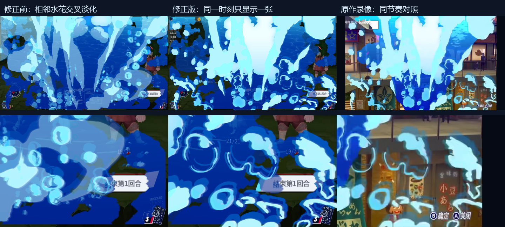

# v0.14.98 水花、立绘与性能修复：修改和安装报告

日期：2026-10-20。分支：`claude/amazing-darwin-b00arn`。

## 交付结果

用户已查看动态对照预览并确认“可以了”“就这样”。本次将确认的修复与远端 v0.14.98 合并，安装到本机游戏 v0.111.0 和 v0.107.1。两边安装文件哈希一致，旧文件已备份。

- P3Makoto：0.14.98。
- P3MusicBox：1.1.3，两边均更新清单和 DLL。
- P3TestMod：1.2.2，仅更新原本已安装的 v0.111.0；v0.107.1 没有该工具，继续跳过。
- 三个项目 Release 编译均为 0 警告、0 错误。
- 两个游戏版本兼容检查均通过，分别检查 P3Makoto 1171、P3MusicBox 249、P3TestMod 382 处引用。
- 未启动游戏、未改存档；静态检查和离线预览不能代替当前安装包的实机验收。

## 我做的修改

### 1. 去掉水花相邻帧融合，恢复清晰轮廓

旧实现每次刷新同时显示两张水花，在两张之间交叉淡化。两张水滴位置不同，淡化中途会出现两套轮廓；这与用户反馈的杂乱和发晕相符。

修改后：
- 水花着色器只有一个可见水花采样，同一时刻只显示当前一张。
- 参考原作现有录像的约 66.7 ms 换形态节奏，采用 15 次/秒的形态更新；这不是把整个画面限制到 15 FPS。
- 末尾平滑淡出只作用于当前水花，不叠加下一张。
- 水下露出在约 0.40 秒完成，与调整后的水花节奏同步。
- 以真实时间直接选当前帧，迟到时跳到应有进度，不补播过期形态。
- 人物骨骼与水面形变仍独立连续插值。
- 新增纯时间轴 `mod/src/Core/DiveTimeline.cs`，供运行时和离线预览共同取样。
- 日志中 `perf dive ... splash=single15` 可识别这套播放方式。

原作观察与限制详见 [水花调查](splash_cadence_audit_20261020.md)。原作底层渲染刷新率未由录像证明；这里校准的是可见水花形态的更新节奏。



### 2. 修正水花尺寸与露出遮罩

- 对照原作连续帧测量摆放；去掉旧版横向约 106%、纵向约 160%、顶部负偏移的放大。
- 前八张以视口为基准铺放；末两张保留 908×600 裁切图相对于 961×949 单元的比例。
- 重新生成 10 张累计水下露出遮罩。
- 新增 `tools/p3r/dive_geometry.py`，供资源整理脚本复用，依赖 NumPy/Pillow；无需 SciPy。
- 修正后的 22 份入水资源可从仓库原素材逐字节复现，包括 10 张水花、10 张遮罩及两份波浪数据。

### 3. 修复人物和水面“突然掰正”的衔接

- 原作 In 动画末帧仍有静态弯曲，旧版随后把形变强度快速归零，造成突兀转正。
- 新增原作 `Loop_L` 的 210 帧网格偏移，In 的 75 帧结束后继续同一网格基准。
- In 末帧与 Loop 首帧、Loop 首尾均校验连续。
- 全部偏移一次上传为 GPU 缓存，播放时只更新帧号并插值，避免逐帧新建/上传位移贴图。

### 4. 立绘暗部颜色

- 保留原贴图中的黑色飘带、耳机线、眼线等深色笔画，避免被统一蓝色映射和明亮边缘光抬亮。
- 深色区域保留少量受光和反光层次，避免变成无层次的纯黑剪影。
- 运行时与离线渲染材质同步修正。
- 用户已撤回的“左半边非水域”实验已撤掉，本次未包含这项实验。

### 5. 保留首次打开抽牌堆的性能优化

保留此前提交 `6a78bb7d` 的小字体、按需构建特写/名牌及预热调度优化，未恢复旧的全量 MSDF 首遇生成路径。

与 v0.14.98 合并时，说明文字同一行既要保留新 `noteL` 引用，又要保留轻量字体。已明确合并两种需求；新增的排列切换文字也使用轻量字体，并补入预热文案。

字体子集扩充为 360 字符、175,720 字节；生成脚本逐字校验字形轮廓、水平度量及覆盖与原字体一致。字体族重命名和 SIL OFL 授权说明保留。

## 合入的 Claude 改动

本次先读取 `docs/codex/README.md`，按其中的协同规则先提交本地修复，再合并远端，编译和兼容检查通过后推送。

远端本次新增 v0.14.98：
- 抽牌堆默认采用原版抽牌堆查看界面的显示顺序。
- 可在“原版顺序”和“按类型”之间切换，设置持久化；切换时复用卡牌。
- 保留远端离线渲染工具对小数帧和页级人物偏移的支持。

主要提交：

| 提交 | 内容 |
| --- | --- |
| `6a78bb7d` | Codex：首次打开抽牌堆的小字体与延迟构建优化，来自先前已完成的本地修复 |
| `1d00ae33` | Codex：立绘暗部、水花单帧节奏、尺寸和连续水面循环；附时间轴测试、调查与待办 |
| `8f7d6b46` | Claude：v0.14.98 原版抽牌堆顺序及排列切换 |
| `5498eb9b` | Claude：协同 README 和 v0.14.98 构建文档更新 |
| `9e797e15` | Codex：合并 v0.14.98，同时保留字体/特写优化并覆盖新增切换文案 |

构建源码基点为 `9e797e15`。后续文档提交只记录交付事实，不改变本次 DLL。

## 验证

| 项目 | 结果与边界 |
| --- | --- |
| 动态预览 | 1280×720、60 Hz 输出，水花前后对照与原作录像对照；用户已确认。为离线渲染，不是游戏实录 |
| 时间轴 | 52 项生产逻辑检查通过：换帧边界、淡出连续、卡顿后直接取样、露出和循环计时 |
| 着色器 | D3D12 和 OpenGL 均通过单帧颜色、预乘透明度、淡出、继承透明度和画布外裁剪检查 |
| 几何资源 | 22 份入水资源逐字节复现，入场与循环端点连续 |
| Release | 三个 mod 均 0 警告、0 错误 |
| v0.111.0 / v0.107.1 | 两次 API 检查全部找到 |
| 安装 | 两边各文件与源产物 SHA256 相符，更新前有备份 |

D3D12 独立检查有引擎自身“PSO caching is not implemented yet”警告；检查通过，没有把它记作修复失败。

本次没有重测整个游戏的 FPS 或所有旧 BUG，不能据此承诺所有电脑上的卡顿已根治。

## 安装位置与备份

| 游戏 | P3Makoto 实际目标 |
| --- | --- |
| v0.111.0 | `C:\Users\kkk\Desktop\slaythespire\Slay the Spire 2\mods\P3Makoto` |
| v0.107.1 | `C:\Users\kkk\Downloads\Slay the Spire 2\mods\P3Makoto\P3Makoto` |

旧文件备份在仓库 `mod/_build/`：
- `backup_visual98_20261020_071151_111/`
- `backup_visual98_20261020_071151_107/`

每份备份包含对应 P3Makoto、音乐盒及已安装测试工具的更新前文件。音乐、歌词未改；没有执行 playlist 改名（已是 txt 或没有需改名文件）。

v0.111.0 的其他 mod 目录未改：
`[IP直连1.4.0][v0.111]`、`mvm`、`quickRestart2`、`TowerMaster`、`万象辉星0.3.0(1)`、`刘川 战士 动画测试版 20260914 新待机与打击特效 v2`。
v0.107.1 未发现其他 mod 目录。

安装产物：
- PCK：127,249,924 字节，92 个 OGG，22 份入水资源。
- DLL SHA256：`4E1F3BEB9AE21C1D74FA6ECDDF0C0FC98C8549EFFA5FC0A5AA7B7851572DFC4E`
- PCK SHA256：`3323809CA022C43868F47F79BAECCAE61DB7D67030B2E07A3A37BEA8FACC14F8`

完整机器可读记录见 [安装校验](visual_hotfix_20261020/install98-single-splash.json)。

## 旧 BUG 状态

原始反馈约来自 v0.14.76 / v0.14.88，不能视作本版复现记录。详见 [待办](player_reported_bugs_20261020.md)。

- 战斗高伤害/万向斩慢放：仍待复现，已有恢复保护不等于根治。
- 战后奖励手柄左右颠倒：仍待针对性修复与验收。
- 强制分类：本次合入的 v0.14.98 已为**抽牌堆**加入独立排列切换，待实机验收；整副牌组仍按类型分类。
- 建筑师特殊 CG 手柄：已有确认键处理，仍待完整流程验收。

## 两次兼容检查原文

### v0.111.0

```text
游戏程序集：C:\Users\kkk\Desktop\slaythespire\Slay the Spire 2\data_sts2_windows_x86_64\sts2.dll（sts2 + GodotSharp，14586 个类型）

== P3Makoto.dll ==
检查了 1171 处引用

== P3MusicBox.dll ==
检查了 249 处引用

== P3TestMod.dll ==
检查了 382 处引用
结果：全部能找到 ✓
```

### v0.107.1

```text
游戏程序集：C:\Users\kkk\Downloads\Slay the Spire 2\data_sts2_windows_x86_64\sts2.dll（sts2 + GodotSharp，14235 个类型）

== P3Makoto.dll ==
检查了 1171 处引用

== P3MusicBox.dll ==
检查了 249 处引用

== P3TestMod.dll ==
检查了 382 处引用
结果：全部能找到 ✓
```

## 用户自行验收要点

1. 冷启动后直接打开抽牌堆，检查首次卡顿、中文与特写；不要求先停留等预热。
2. 打开牌组，检查水花轮廓、末尾淡出，以及人物/水面入场后不再突兀掰正。
3. 抽牌堆说明条右侧切换“原版顺序 / 按类型”，检查卡牌排列和记忆设置。
4. 需要核对加载版本时，日志应有 `[P3Makoto] init v0.14.98`，播放入水后性能行应含 `splash=single15`。


